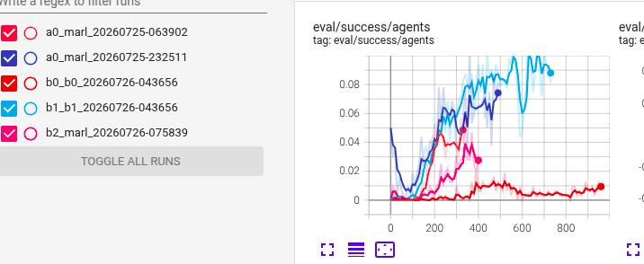

# marl
re-implemented Multiple Landmark Detection using Multi-Agent Reinforcement Learning for face landmarks detection

## dataset 
subset of WFLW

## hybrid scheme: heatmap prior + RL refinement (cfgs/c0.toml)
Agents are initialized at heatmap-network peaks (+ annealed jitter), so RL only refines
locally instead of searching the whole face (init err 0.73 -> 0.03 in smoke tests).

```bash
# stage 1: train the heatmap prior
uv run python -m marl.src.main train_heatmap --dataset_root D:/dataset/WFLW \
    --epochs 60 --batch_size 8 --lr 1e-3 --out_dir runs/heatmap_prior

# stage 2: marl training with heatmap init (edit heatmap_weights in c0.toml first)
uv run python -m marl.src.main train --config_file marl/cfgs/c0.toml --dataset_root D:/dataset/WFLW
```

notes:
- clean-subset filter leaves only ~309 train images; longer training / augmentation helps the prior
- eval logs `eval/init_err` (mean heatmap-init-to-gt distance) alongside success metrics

## training health & internals (2026-10)
- **per-agent termination**: each agent freezes once within UNIT_STEP of its target (stops moving &
  collecting; replay/training continues) -- success recorded at arrival time; disable via
  `per_agent_done = false` to reproduce the old all-or-nothing behavior
- **frame-level replay buffer**: one uint8 frame per transition, stacked obs rebuilt on sampling
  (~9.6GB -> ~250MB for 5 agents x 4096); checkpoints store buffers only if `save_replay = true`
- **joint shared-encoder update**: single Adam, encoder gradient = mean over active agents
  (was: 5 conflicting sequential optimizer steps with stale per-optimizer state);
  `lr` / `encoder_lr` / `loss_type = mse|huber` configurable
- **TD-error monitoring**: per-agent `td/*` curves (abs/signed/relative TD, Q means), validation TD
  on fresh samples, and automatic health alerts -- how to read them: `docs/td-error-guide.md`

## eval/success/agents  

### top config: b1.toml
* long training
* frequently target update


